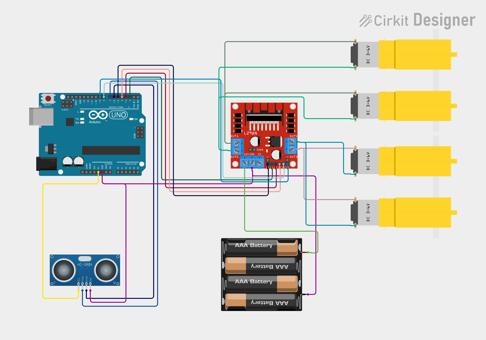

# Obstacle-Avoiding Robot

An Arduino-based obstacle-avoiding robot designed using Cirkit Designer. This project demonstrates sensor interfacing, motor control, and embedded systems fundamentals.

## Project Overview

The robot uses an ultrasonic sensor to detect obstacles and controls its motors through a motor driver to change movement according to the programmed logic.

## Objectives

- Detect obstacles using an ultrasonic sensor.
- Measure distance to objects.
- Control DC motors using a motor driver.
- Design and document the circuit using Cirkit Designer.

## Circuit Diagram

## Online Circuit Design

Open the interactive circuit in Cirkit Designer:

**[View the circuit online]** https://app.cirkitdesigner.com/project/917c01e4-23d5-4868-a32a-66e8b41b3261

## Firmware

The Arduino source code is available here:

[View Arduino firmware](firmware/obstacle-avoidance.ino)

## Hardware Components

- Arduino UNO
- Ultrasonic distance sensor
- Motor driver module
- DC motors
- Battery pack
- Robot chassis and wheels

Verify this list against the components in your actual design.

## Software Tools

- Cirkit Designer
- Arduino IDE

## Testing and Results

Add your actual simulation results, measured distance range, motor response, and hardware testing observations here.

Clearly distinguish simulated behaviour from physical hardware testing.

## Repository Structure

- `hardware/` — circuit image and design documentation
- `firmware/` — Arduino source code
- `README.md` — project overview

## Author

**Name:** Dommeti Venkata Shyam Surya

**Department:** Electronics and Communication Engineering

**Institution:** Bonam Venkata Chalamayya Engineering College

## Future Improvements

- Improve obstacle detection and turning logic.
- Add servo-based scanning if supported by the design.
- Evaluate performance under different obstacle distances.

